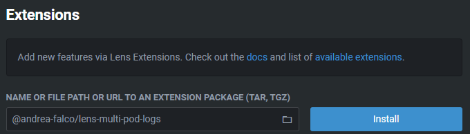
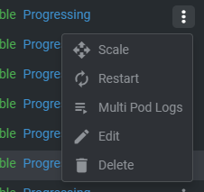
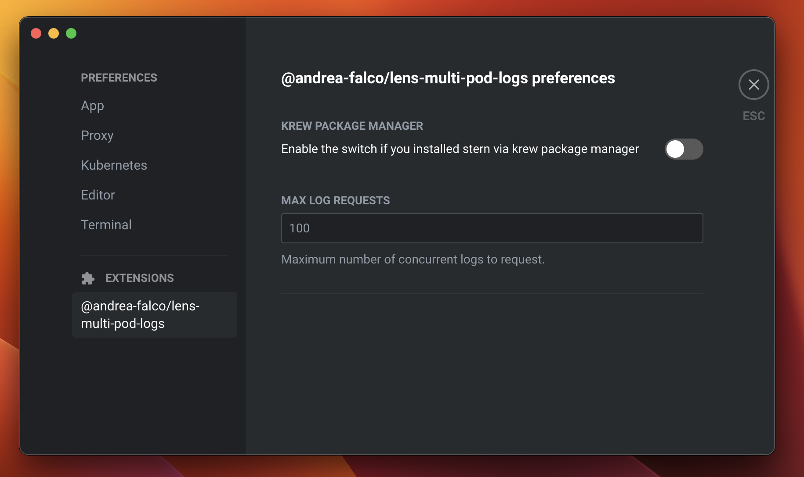

# Extensión Multi Pod Logs para Lens
Una extensión para [Lens](https://k8slens.dev) (o [OpenLens](https://github.com/lensapp/lens)) que te permite ver los registros (logs) de varios pods *(y múltiples contenedores dentro del pod)* en Kubernetes.

<p align="center">
   
 <br>
 <a href="https://ko-fi.com/A0A8J3CMJ"></a>
</p>

## 🚧 Requisitos
- Lens (u OpenLens) `>= 6.0.0`
- [stern](https://github.com/stern/stern/releases) `>= 1.30.0`
> ⚠️ Esta extensión utiliza `stern` bajo el capó, por lo que debe estar instalado en tu computadora para que la extensión funcione.
> Si no sabes cómo instalarlo, puedes seguir [estos pasos](STERN.md).

## 🧰 Instalación
Asegúrate de que Lens esté en ejecución y sigue estos simples pasos:

 1. Ve a la vista de Extensiones (`Menú -> Archivo -> Extensiones`)
 2. Ingresa el nombre de esta extensión, `@andrea-falco/lens-multi-pod-logs`
 3. Haz clic en el botón **Instalar**
 4. Asegúrate de que la extensión esté habilitada



---

## 🚀 Características
Tras completar la instalación, verás una nueva acción **Multi Pod Logs** en el siguiente menú:
- Deployments
- StatefulSets
- ReplicaSets
- DaemonSets



La nueva acción abrirá una nueva terminal donde se mostrarán todos los registros provenientes de todos los contenedores de todos los pods del recurso.

## ⚙️ Preferencias
Algunos comportamientos y parámetros de la extensión se pueden ajustar desde la página de preferencias de Lens, en la sección correspondiente dedicada a la extensión:



## 🎨 Registros con colores
Si estás usando Windows 10/11 *(y PowerShell como terminal en Lens)* y no ves los registros de los pods con colores, puedes habilitar los colores ejecutando este comando:

```
Set-ItemProperty HKCU:\Console VirtualTerminalLevel -Type DWORD 1
```

Luego, reinicia Lens.

---

## Actualización
Para actualizar a una versión más reciente, ve a la vista de Extensiones, desinstala la extensión y vuélvela a instalar.

## Desinstalación
Ve a la vista de Extensiones de Lens y haz clic en el botón **Desinstalar** junto a esta extensión.
